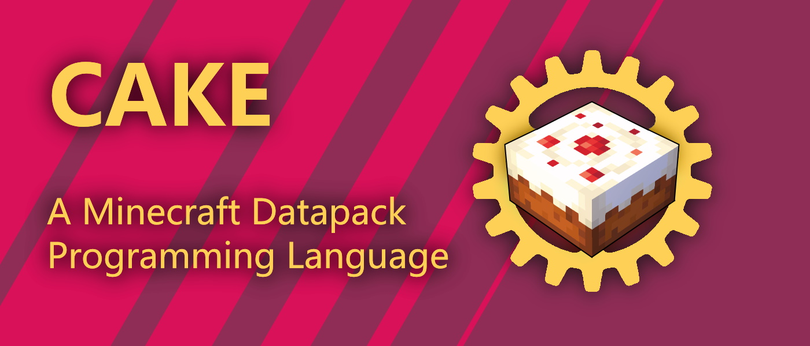

# CakeLang

Cake compiles a deliberately small language subset to **Minecraft Java Edition
1.20.4** datapacks (pack format **26**). Python 3.10+ is required.
There are no runtime Python dependencies. Other Minecraft versions and Bedrock
Edition are not supported.

## Install and run

From a checkout:

```sh
python -m venv .venv
. .venv/bin/activate
python -m pip install .
cake examples/launch.cake --namespace launch --output build/launch
cake examples/target.cake --namespace target --output build/target
cake examples/trail.cake --namespace trail --output build/trail
python -m unittest discover -v
```

Windows users can activate with `.venv\Scripts\activate`.
The installed `cake` command works outside the checkout. `python cake.py` also
works from the checkout. `cake --help` lists options; `--lint` validates without
writing. Errors go to stderr with a nonzero exit code and source line/column.
Output defaults to `build/SOURCE_STEM`, namespace to `cake`. Use distinct
namespaces when installing multiple packs. Existing output directories are
refused: remove an old *generated* pack or choose a new output path.

## Supported language

```text
# Comments run to the end of a line.
say("Hello world");
call("greet");
function greet() {
    command("give @s minecraft:cookie 1");
}
```

A program contains top-level calls and zero-argument function declarations.
Top-level calls become `NAMESPACE:main`; they do not run automatically.
Functions named `load` and `tick` register in Minecraft's load and tick tags.
Other functions run through `call("name")` or Minecraft's `/function` command.
Calls may refer to functions declared later. Semicolons are optional.
Function names use `[a-z_][a-z0-9_]*`; `main` is reserved.

| Call | Output |
| --- | --- |
| `say("text")` | `say text` |
| `command("Minecraft command")` | The command verbatim, without a leading slash |
| `call("local_function")` | `function namespace:local_function` |

Arguments must be JSON-style double-quoted strings. Escaped quotes, backslashes,
and Unicode are supported; empty/whitespace-only strings and control characters
are rejected. Strings do not interpolate Cake expressions.
Minecraft interprets selectors and command text at execution time.
**Cake does not validate Minecraft command grammar**, resource IDs, permissions,
or runtime success. Command syntax must match Java 1.20.4. Function calls inherit
Minecraft's execution context; load/tick have server context, so use
`execute as ... at ...` when a player or position is needed.
Recursive calls are permitted and subject to Minecraft's command limits.

Imports, modules, macros, variables, assignments, arithmetic, Cake selectors,
conditionals, loops, parameters, return values, and nested functions are
unsupported and fail explicitly. Minecraft `execute` may be used inside
`command`. Old material in the wiki and `examples/legacy` describes aspirations,
not implemented features; the legacy examples intentionally do not compile.

## Try the examples

Copy the three generated directories directly into
`<world>/datapacks/`. Each directory must contain `pack.mcmeta` at its root.
Use Java **1.20.4**, enable cheats or operator permission, then run `/reload`
and `/datapack list enabled`.

Run these in player chat in a disposable test world:

- `/function launch:main`: a short levitation ride with slow falling.
- `/function target:main`: gives a bow and arrows and spawns a stationary husk
  eight blocks south. Shoot it; `/function target:cleanup` removes tagged targets
  within 32 blocks. Use an open area and Easy or higher difficulty.
- `/function trail:main`: enables a personal particle trail.
  Walk around; `/function trail:stop` disables it.

The examples change player effects, inventory, tags, and entities.
They do not place blocks. Target drops and given items can remain after cleanup.
Trail tags persist through reloads; stop the trail before removing the pack.

## Verification status

Automated tests cover source errors, unsupported syntax, CLI behavior, all three
example outputs, and exact datapack trees/commands against committed fixtures.
CI builds and installs a wheel into a fresh environment and compiles the examples.

**Minecraft acceptance is incomplete.** No live 1.20.4 client/server playthrough
has been performed for this change. Fixtures establish compiler output, not
gameplay correctness. Follow [the acceptance checklist](docs/acceptance.md)
before calling the examples game-verified.

Format reference: https://minecraft.wiki/w/Data_pack
